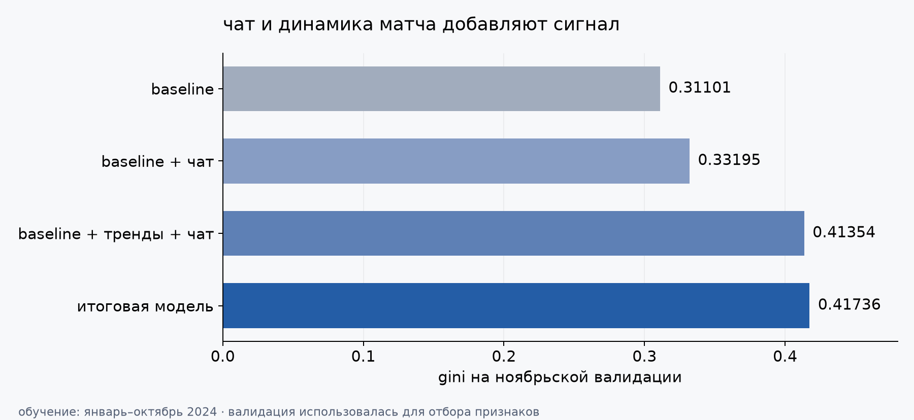

# прогноз победителя dota 2

проект по предсказанию победы radiant. сначала обучается логистическая регрессия на регионах, датах, mmr и героях, потом добавляются чат и преимущество по золоту и опыту за первые 15 минут.

## результат

| модель | gini на ноябре |
|---|---:|
| базовая | 0,31101 |
| с чатом | 0,33195 |
| с трендами и чатом | 0,41354 |
| итоговая | 0,41736 |



обучение — январь–октябрь 2024, проверка — ноябрь, test — декабрь. ноябрь использовался и для выбора признаков, поэтому результат стоит проверить на других месяцах. качество на скрытом test неизвестно.

## что где

- `notebooks/01_baseline.ipynb` — данные, очистка, базовая модель и optuna
- `notebooks/02_features.ipynb` — чат, тренды и итоговая модель
- `data/raw/` — csv с данными, в git не входят
- `artifacts/` — сохранённые модели, параметры и прогнозы
- `reports/` — графики

## запуск

нужен python 3.12. шесть csv из датасета размещаются в `data/raw/`. описание файлов — в [data/README.md](data/README.md).

```bash
python -m venv .venv
source .venv/bin/activate
pip install -r requirements.txt
python run.py all
```

отдельно ноутбуки запускаются через `python run.py baseline` и `python run.py features`. gpu не нужен.

после обучения `python predict.py` сохранит повторные прогнозы в `artifacts/advanced/predictions.csv`. для новых матчей нужно сначала добавить их составы, чат и ряды преимущества в источники модели.

`python build_report.py` обновляет графики и краткие выводы.

## датасеты

[датасет](https://www.kaggle.com/datasets/atolm1110/hota-hw-dataset) · [соревнование](https://www.kaggle.com/competitions/dota-2-hse-ml-1-course-competition-2026)
